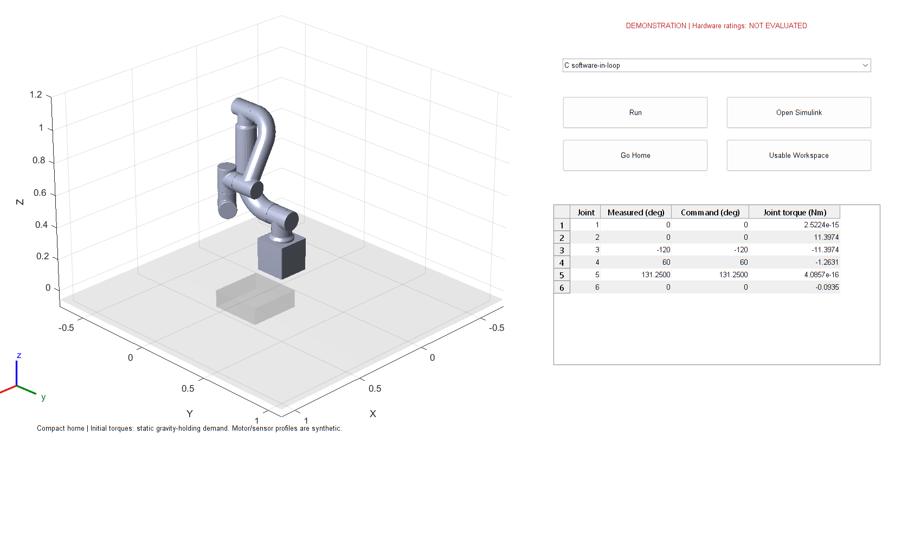
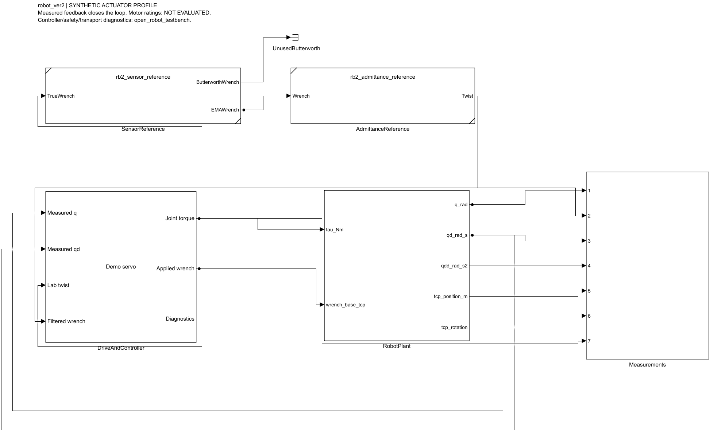

# robot_ver2 Control Testbench

Standalone MATLAB R2024b / Simscape Multibody simulation package. It does not
load `Final_Architecture`, `projectConfig`, or another robot's mesh directory.

## Open

In MATLAB, set Current Folder to **this folder**, then type:

```matlab
open_robot_testbench
```

Choose a mode and click **Run**. The initial selection executes the actual C
admittance and joint mapper in simulation time. Mechanics Explorer displays physical motion; the results window
shows measured joint angles, joint torques and command tracking errors.
**Open Simulink** opens `robot_ver2_testbench.slx` directly.

Requirements: MATLAB R2024b, Simulink, Simscape, Simscape Multibody, Robotics
System Toolbox and Signal Processing Toolbox. The external network also uses
Instrument Control Toolbox (`udpport`). Rebuilding/native C tests require a
configured MATLAB C compiler (`mex -setup C`). The supplied SLX is already built.

## Modes

- **C software-in-loop, default:** MATLAB calls the original C `admittance_step`
  and `cartesian_joint_mapper_step` at 2 ms simulation intervals, with matched
  robot_ver2 kinematics, measured Multibody feedback and the synthetic sensor
  reference. This is repeatable algorithm/physics testing without a wall-clock
  deadline claim. It does not execute the complete RTOS Supervisor/CAN/storage
  stack or the uncommissioned vendor sensor interface.
- **External C / CANopen:** the teammate controller owns commands. The supplied
  Linux motor-bank adapter retains their AVATAR/CANopen node processing and
  connects commands to MATLAB physics. It publishes positions measured from
  the Multibody plant, never requested positions. See `integration/README.md`.
- **Simulink laboratory:** native R2024b reference subsystems reproduce the
  inspected sensor and Tustin admittance equations. They drive the same robot
  through DLS Cartesian-to-joint mapping. This mode does not claim to execute
  the C Supervisor or its additional saturation/reset gates.
- **Joint-motion demonstration:** a small joint sweep from compact home, using
  the same safety and mechanical model. No external controller is needed.

Only the selected command source controls the physical robot. The inactive
Simulink reference calculations do not cascade into the external C controller.
Use one testbench instance at a time; the in-process C controller owns persistent
state which is explicitly reset at the start of each run.

## Physical Meaning

`mechanics/` contains the corrected robot URDF, unique meshes, link masses,
inertial tensors and fixed TCP. The TCP relative to Joint 6 is
`[-22.87, +20.53, +245.77]` mm, with parallel axes. Torch mass is already in
`End_Effector`; the `tcp` frame adds no mass. Gravity is base-frame -Z.

**Actuators are placeholders, not calibrated AVATAR models.** The demonstration
uses position/speed feedback plus gravity compensation, a bounded motor torque,
first-order torque response, a synthetic 50:1 transmission/effort gain,
synthetic efficiency and viscous friction. It does not model winding circuits,
rotor/reducer inertia, backlash, elasticity, temperature, physical brakes or
vendor servo-loop tuning. These belong in the hardware model when data arrives.
Do not use demonstration results to select/approve motors or gearboxes.

All missing hardware values are grouped in `testbench_config.m`. Ratings are
**NOT EVALUATED**. Hardware-validation mode fails closed while required data or
physical-model validation is missing; merely entering plausible numbers is
not model validation.
Hardware-validation mode also remains blocked until a physical actuator
backend is implemented; filling placeholders or changing approval flags alone
cannot enable it. Simulation faults use synthetic active braking under
gravity, not a certified stop or power-off brake. Actual motion can continue
after a fault; measured state is never frozen or teleported to conceal it.

## Home And Safety

The selected compact home is J1..J6:
`[0, 0, -120, 60, 131.25, 0]` degrees. Mathematical/encoder zero remains distinct.
The model initializes there; initialization is not a simulated homing movement.
**Go Home** during a run validates the entire direct joint-space route before
executing it. If invalid, it refuses; this release does not invent an alternative
collision-free planner route. A recorded home pose is not permission to reach
it from any arbitrary pose.
In external CAN mode, use the controller's own HMI Home command. The dashboard
does not override Supervisor motion authority. In local modes, Go Home takes
exclusive command ownership and holds home for the remainder of that run.

Every commanded and measured step is checked against provisional +/-180-degree
joint limits, linear TCP inverse condition >=0.20, full-task minimum sigma,
self-collision/clearance and configured environment geometry. Parent/child pairs
are excluded as in the established analysis; nonadjacent pairs are checked.
STL collision shapes are convex approximations. Interpolated motion is checked
at <=0.5-degree increments: bounded sampling is not continuous collision proof.
Nearby poses may reuse prior exact pairwise clearances only when conservative
per-body translation/rotation bounds prove the margins cannot be consumed. Reported
clearance in that case is a lower bound, not a new exact distance. Every run
creates a fresh cache, hashes the STL contents and reloads collision geometry.
Full mesh checks can make simulation substantially slower than real time.
Use the simulation-time C mode for algorithm studies; a live CAN run must pass
the existing controller timing gates, not merely produce an animation.

The linear inverse-condition number does not detect every orientation/wrist
singularity. Full-task sigma is a separate mixed-unit diagnostic/guard, not a
second interpretation of the 0.20 threshold. Unknown mechanical limits remain
marked provisional. A workspace cloud/envelope is not used as a safety gate.

The Usable Workspace button computes a reproducible 2,000-configuration preview,
using actual TCP positions and the same filters. The cloud is an approximation,
not all reachable configurations. Workcell boxes and operator forces are
synthetic/configurable. No physical surface-contact response is claimed.

## Sources And Maintenance

Immutable upstream snapshots are in `vendor/`, with their original ZIPs:

- Control: `sara/can-replacement`, commit `15aa22efc071554fe06f1e42e1007633dee15cc9`.
- Admittance: `main`, commit `589df87e0b36dfb707394ef959a6441456e408e6`.

`control/` contains allocation-bounded robot-specific C FK, Jacobian and
closed-form IK. Transform arrays are row-major; units are metres/radians;
Jacobian order is [linear; angular]. Up to eight IK branches are returned,
limit/FK checked and ordered by wrapped-angle seed distance. Existing trajectory
continuity checks must still reject a branch jump across a mechanical stop.
Exact wrist-degenerate branches
are not exhaustively enumerated: failure is not proof of unreachability.

Original R2025b subsystem files remain untouched in `vendor/`. R2024b-native
reference diagrams are rebuilt from their inspected basic-block equations.
The sensor preserves bias/noise/drift/coupling/tare and EMA/Butterworth outputs.
Like the inspected SLX, it does not implement the separate MATLAB sensor
function's quantization/saturation stages. Hardware sensor behavior is not
validated. No automatic parameter optimization silently retunes the controller.

Run `build_robot_testbench` to regenerate the model, C geometry and native MEX
helpers. Save/close unsaved model edits first. Regeneration replaces generated
models; put controller changes in reviewed source/integration files instead.
See `TEAMMATE_CHANGES.md`, `HARDWARE_DATA_NEEDED.md` and `VERIFICATION.md`.




